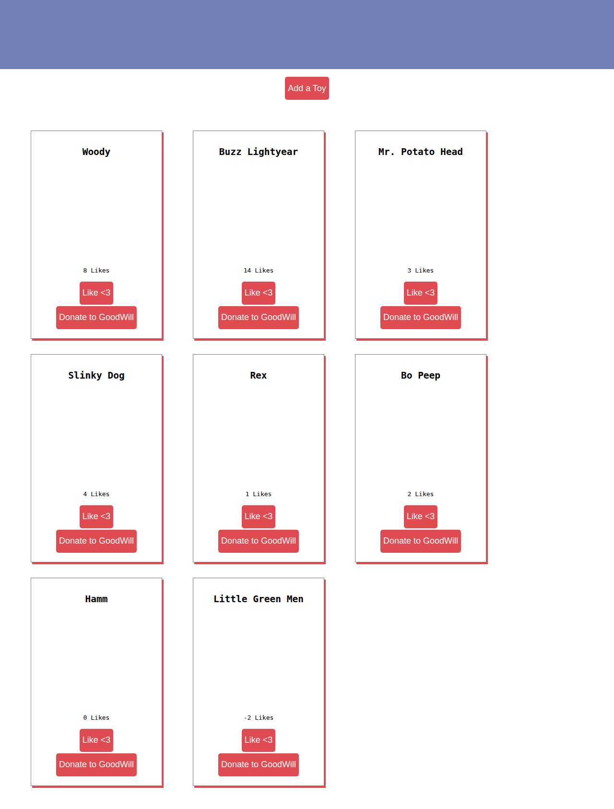

# Toy Tales

Toy Tales is a React toy collection backed by a local JSON Server API. Browse
the collection, add toys, increase likes, and donate toys to remove them.

## Run Locally

Install dependencies:

```sh
npm install
```

Start the API in one terminal:

```sh
npm run server
```

Start the React app in another terminal:

```sh
npm run dev
```

Open the URL printed by Vite (by default, `http://localhost:5173`). Run the
automated tests with:

```sh
npm test -- --run
```

The app uses `http://localhost:3001/toys` by default. To use another API URL,
set `VITE_TOYS_API_URL` when starting Vite, for example:

```sh
VITE_TOYS_API_URL=http://localhost:3002/toys npm run dev
```

## Features

- Loads and displays toys from the API on page load.
- Creates toys with an initial like count of zero.
- Updates the selected toy's likes without changing its position in the list.
- Deletes donated toys from the API and collection.

## Screenshot


